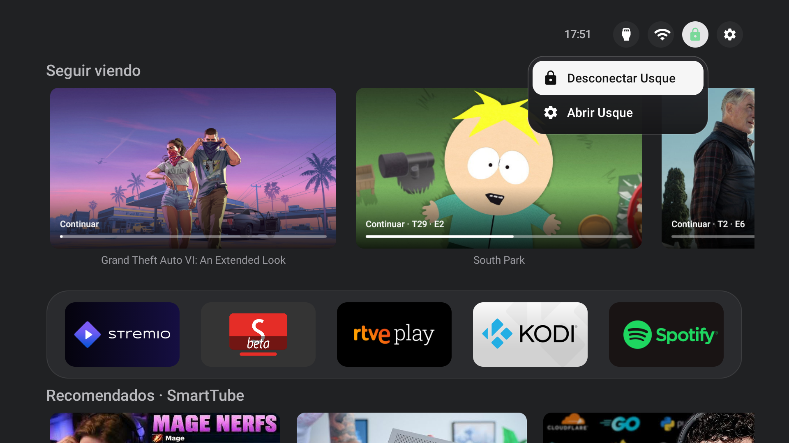

# firetv-customhome

Una pantalla de inicio sencilla para Fire TV, con «Seguir viendo» de Stremio, recomendaciones de SmartTube y acceso a la VPN.

**[English](README.md)** · **[Descargar el instalador](https://github.com/nukeador/firetv-customhome/releases)**

> **Versión preliminar:** la instalación y la recuperación completas aún no se han probado en un segundo Fire TV. Cambiar el botón Inicio puede colgar o reiniciar el dispositivo. Sigue las instrucciones del instalador y conserva la copia que crea.

## Instalación

1. Descarga la última versión preliminar desde la [página de versiones](https://github.com/nukeador/firetv-customhome/releases). Elige Windows, macOS con Apple Silicon o Linux y descomprime el archivo.
2. Conecta el ordenador y el Fire TV a la misma red.
3. En el Fire TV, entra en **Ajustes → Mi Fire TV → Acerca de** y pulsa siete veces el nombre del dispositivo. Vuelve atrás, abre **Opciones para desarrolladores** y activa **Depuración ADB**. Busca la dirección IP del Fire TV en **Acerca de → Red**.
4. Abre la carpeta descomprimida e inicia el instalador:
   - **Windows:** haz doble clic en `Start.bat`.
   - **macOS:** haz doble clic en `Start.command`. Si macOS lo bloquea, autorízalo en Ajustes del Sistema.
   - **Linux:** abre una terminal en la carpeta y ejecuta `./Start.sh`.
5. Responde a las preguntas en el ordenador. Cuando la TV pregunte **¿Permitir depuración USB?**, acepta con el mando. El instalador te deja elegir qué aplicaciones instalar y qué limpiar.
6. Inicia sesión con tus cuentas. Conecta Stremio desde el acceso al final de la lista de aplicaciones. Si no aparecen recomendaciones de SmartTube, abre SmartTube Beta y activa su servicio de canales.

Puedes volver a ejecutar el instalador si quedó a medias: muestra lo que ya está instalado y permite elegir cada paso. El puente de SmartTube se puede instalar antes que SmartTube.

Mantén pulsado **OK** sobre una aplicación para cambiarla de sitio. Pulsa **Menú** sobre ella para abrir sus ajustes. Se conservan la configuración y el orden de un launcher ya instalado; en una instalación nueva puedes ordenar las aplicaciones a tu gusto.

Conserva la copia creada por el instalador. Puedes volver a abrirlo para restaurar las aplicaciones desactivadas; los datos borrados no se pueden recuperar. El cambio del botón Inicio solo está disponible en la versión de Fire TV compatible; en otras puedes abrir el launcher como una aplicación.

[Privacidad](PRIVACY.md) · [Documentación técnica](docs/DEVELOPMENT.md) · [Licencia](LICENSE)
