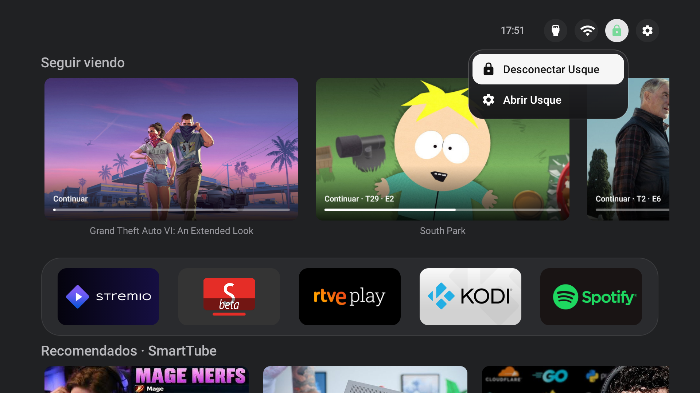

# firetv-customhome

A simple Fire TV home screen with Stremio’s Continue Watching, SmartTube recommendations and a VPN shortcut.

**[Español](LEEME.es.md)** · **[Download the installer](https://github.com/nukeador/firetv-customhome/releases)**

> Tested with **Fire TV Stick 4K Max (1st generation)** and **Fire TV Stick (3rd generation)** on supported software versions. Changing the Home button can restart or freeze the device. Follow the installer and keep its backup.

## Install

1. Download the latest version from the [releases page](https://github.com/nukeador/firetv-customhome/releases). Choose Windows, macOS with Apple Silicon, or Linux, and unzip the file.
2. Connect your computer and Fire TV to the same network.
3. On the Fire TV, open **Settings → My Fire TV → About** and press the device name seven times. Go back, open **Developer options**, and turn on **ADB debugging**. Find the Fire TV’s IP address in **About → Network**.
4. Open the extracted folder and start the installer:
   - **Windows:** double-click `Start.bat`.
   - **macOS:** double-click `Start.command`. If macOS blocks it, allow it in System Settings.
   - **Linux:** open a terminal in the folder and run `./Start.sh`.
5. Use the arrow keys and Enter to choose a task, then follow the questions on your computer. When the TV asks **Allow USB debugging?**, accept with the remote. The installer lets you choose which apps to install and what to clean up.
6. Sign in to your own accounts. Connect Stremio using the shortcut at the end of the app list. If SmartTube recommendations are missing, open SmartTube Beta and enable its channel service.

Choose **Clean up Amazon apps** from the menu to run cleanup on its own. On the third-generation Stick, this option has not yet been tested on a physical device.

The installer can block Fire OS updates to reduce the chance of losing your custom Home. You can enable them again from **Block or enable system updates** in the menu. Blocking also prevents security fixes and cannot guarantee Home will persist.

You can run the installer again after an interruption: it shows what is already installed and lets you choose each step. The SmartTube bridge can be installed before SmartTube.

Hold **OK** on an app to rearrange it. Press **Menu** on an app to open its settings. Existing launcher settings and app order are preserved; on a new installation you can arrange the apps yourself.

Keep the backup created by the installer. You can reopen it to restore disabled apps; deleted app data cannot be recovered. Replacing the Home button is available only on the supported Fire TV version; on others the launcher opens as an app.

[Privacy](PRIVACY.md) · [Technical documentation](docs/DEVELOPMENT.md) · [License](LICENSE)
